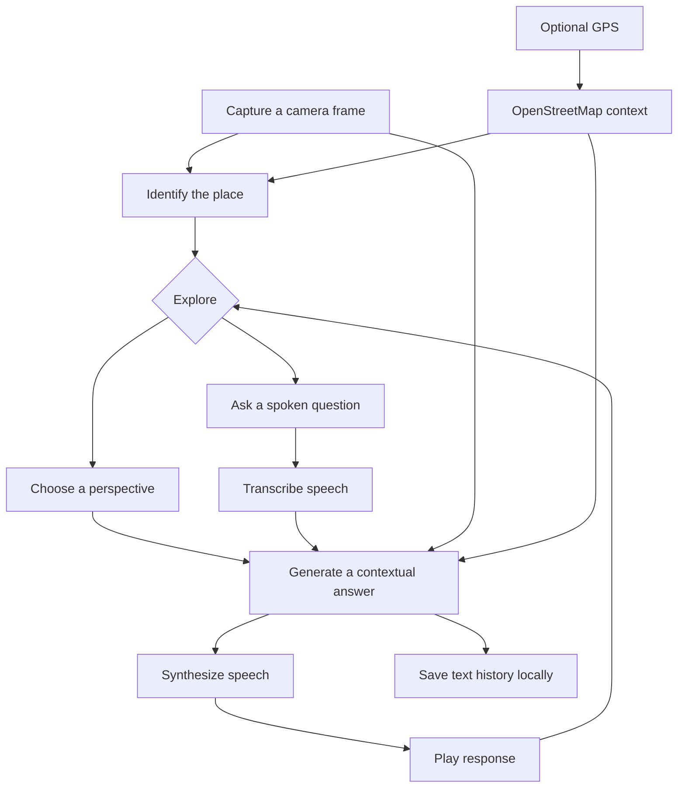

# Voice Field Guide

**Turning real-world exploration into a conversation.**

Voice Field Guide is a mobile-first, multimodal AI companion for understanding the places in front of you. Point a camera at a landmark, landscape, or everyday structure; identify it using visual and geographic context; then explore it through spoken explanations and follow-up questions.

**[Read the case study](https://portfolio-v2-gray-six.vercel.app/work/voice-field-guide)**

*Independent project · Product design & development · 2026*

<p align="center">
  
</p>

*An identified place stays in context while the user changes perspectives or asks another question.*

## The product question

**How can an AI guide understand what someone is looking at and turn that context into a natural, reliable conversation?**

Discovering a place often means interrupting the experience to search for it. I built this prototype to explore a different interaction: look at something interesting, receive a relevant explanation, and keep asking questions without switching contexts.

## Try the experience

1. **Capture.** Point the camera at a place, optionally using device location.
2. **Identify.** Vision and geographic clues produce a name or cautious description.
3. **Explore.** Choose **Why here?**, **What people miss**, or **How it works**.
4. **Ask by voice.** Speak a follow-up and hear a contextual answer.
5. **Revisit.** Find explored places and answers in browser-local history.

The captured image and conversation context carry through follow-up questions.

## How it works



The frontend coordinates the experience through `useCompanion`. Next.js API routes handle identification (`/api/identify`), responses (`/api/ask`), transcription (`/api/transcribe`), and speech generation (`/api/speak`). OpenAI API credentials stay server-side.

| Component | Responsibility |
| --- | --- |
| Camera and image input | Capture the scene for identification and subsequent answers |
| GPS and OpenStreetMap | Supply optional geographic clues about nearby places |
| Vision and language model | Identify the subject and generate explanations |
| Speech-to-text and text-to-speech | Enable spoken questions and audio responses |
| Client-side session state | Preserve the original subject and conversational context |
| Browser local storage | Save explored places, answer text, and optional coordinates without an account |

### Design and engineering decisions

**Ground without overclaiming.** GPS provides clues, but the model is prompted to name a place only when the image and location plausibly agree.

**Keep context stable.** Follow-ups reuse the image, place identity, and answer history instead of restarting the conversation.

**Use one model across subjects.** Three perspectives work for nature, architecture, and infrastructure.

**Save history locally.** No accounts or database; explored places and text answers stay in browser storage.

## Current scope and limitations

The core camera-to-identification-to-spoken-answer flow is implemented. The application is a working research prototype, not a production travel guide.

- **Recognition is probabilistic.** Prompt instructions encourage uncertainty but do not provide verified confidence estimates or guarantee factual accuracy.
- **Response time varies.** The interaction depends on multiple model requests, geographic services, and audio synthesis.
- **Validation is limited.** The repository does not contain a formal accuracy benchmark, automated test suite, or broad usability study.
- **Privacy is prototype-level.** Camera images, audio questions, and optional location information pass through server routes and relevant external providers to fulfill requests. Saved place history (including coordinates if available) stays in the browser's local storage.

Next steps are improving landmark identification, reducing conversational latency, testing with more travelers, and expanding accessibility and privacy controls.

## Run locally

**Requirements:** Node.js 20+ and npm; an OpenAI API key.

```bash
git clone https://github.com/radiiiianttt/voice-field-guide.git
cd voice-field-guide
npm ci
cp .env.example .env.local
```

Add your key to `.env.local`:

```dotenv
OPENAI_API_KEY=your_api_key_here
```

Start the application:

```bash
npm run dev
```

Open [http://localhost:3000](http://localhost:3000). Camera and microphone permissions are required for the full experience. On a phone, use an **HTTPS** deployment: a plain local-network HTTP URL will generally not provide the secure context required for camera access.

The server-side implementation uses `gpt-4o` for image identification and answers, `gpt-4o-mini-transcribe` for transcription, and `gpt-4o-mini-tts` for audio playback.

## Project map

| Path | Purpose |
| --- | --- |
| [`app/api/`](app/api/) | Server-side identification, answer, transcription, and speech endpoints |
| [`components/`](components/) | Camera interface, place panel, voice UI, and history |
| [`hooks/`](hooks/) | Camera, microphone, location, session orchestration, and local history |
| [`lib/`](lib/) | Prompts, OpenAI integration, geocoding, modes, and shared types |

**Stack:** Next.js 15 · React 19 · TypeScript · Tailwind CSS 4 · OpenAI APIs · OpenStreetMap · Vercel

## License

[MIT](LICENSE)
